

  

<h1 align="center">WorthSplit</h1>

<strong>Your money. Finally clear.</strong>

<strong>English</strong> · <a href="README.it.md">Italiano</a>

  
  
  

WorthSplit is a personal, mobile-first and installable web app that splits your net worth into **buckets** and keeps track of where every euro sits. It is not a budgeting app: it focuses on balances, moves between buckets and the expenses that are coming, with a clear overview on both phone and desktop.

> The app interface is in Italian, as the screenshots show.

  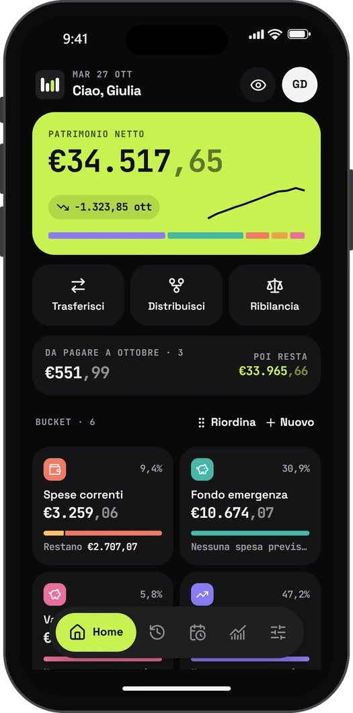
  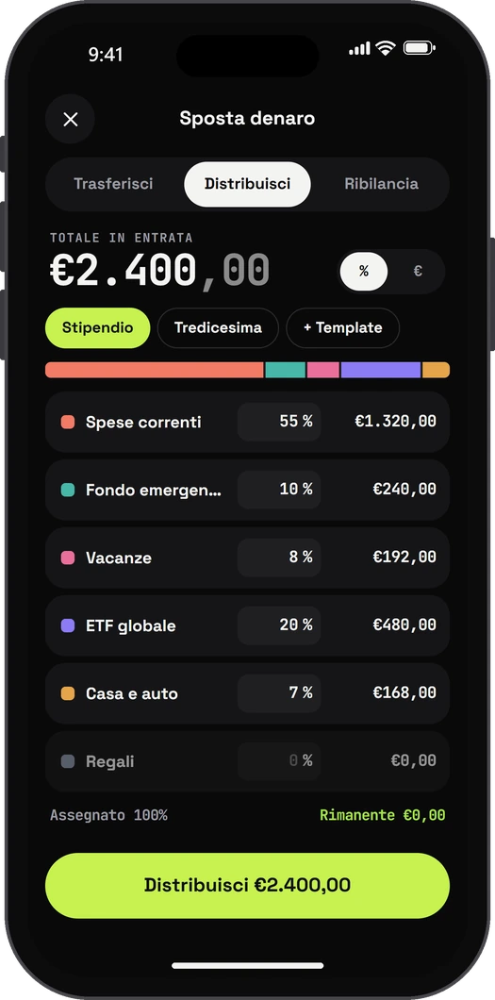
  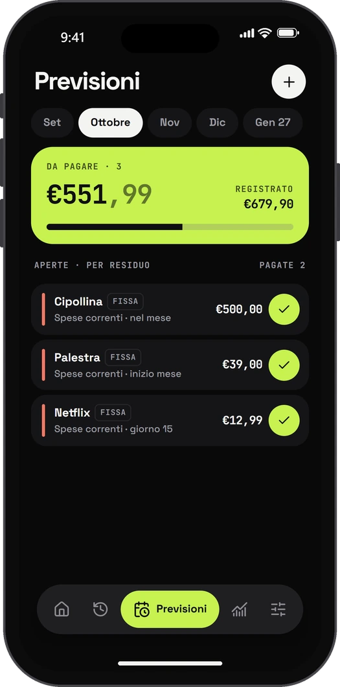

## Why WorthSplit

Money has different purposes: day-to-day spending, an emergency fund, holidays, investments. WorthSplit keeps each one in its own bucket and always shows three things: how much you have, where it is, and how much is really left once the expenses you already expect are paid.

- Net worth you can read at a glance, with its split across buckets.
- Every move recorded in a history that is never rewritten.
- This month's planned expenses set aside in advance, bucket by bucket.
- Private data, synced across devices, with no analytics and no ads.

## Features

### Home

- Net worth with its recent trend, the change this month and a composition bar.
- Monthly summary: what is still due and what is left **after** it.
- Bucket cards with balance, share of the total and a bar showing the part already committed to planned expenses, with what **remains** once they are paid.
- Drag-and-drop bucket ordering, touch included.
- On desktop: a grid view with quick transfer, latest operations and upcoming payments.

### Moving money

- **Transfer** between two buckets with an on-screen keypad, 25%, 50% and All shortcuts, and both balances shown before and after.
- **Distribute** an income across several buckets by fixed amounts or percentages, with the assigned share and the remainder updated live.
- Saved distribution **templates**, applied in one tap (for example "Salary" or "13th-month pay").
- **Rebalance** buckets against the real bank balance: choose the order in which buckets absorb the difference and see, for each one, the balance before, after and the change.
- From a bucket's detail page: add to, subtract from or set its balance directly.

### Planned expenses

- Fixed or estimated amounts, recurring or one-off, grouped by category: subscriptions, instalments, one-off and other.
- Monthly, bimonthly, quarterly, half-yearly and yearly frequencies, due at the start, middle or end of the month or on a given day.
- Month-by-month view of what is open and what is already paid. For estimated expenses the amount **due** is always what remains, and what has already been charged stays visible.
- Partial payments, corrections and reopening an expense already closed.
- An expense can be left out of the estimated total from a chosen month onwards.

### Operations and trends

- Full history with filters by operation type and search, paginated on desktop.
- Trends over 6 months, 1 year or the whole history, with each bucket's composition and change.

### Settings

- Profile with **photo**, name and password change.
- Buckets, planned expenses and templates managed from dedicated pages (a side drawer on desktop).
- Light, dark or automatic theme, and amounts hidden in one tap.
- Full **backup**, exported in plain form or encrypted on the device with AES-256-GCM, with a history of past exports. Importing shows what the file contains and compares it with the current data before replacing it.
- **Reset data**, partial (operations and balances) or total, protected by a confirmation word.

### Accounts and privacy

- Multiple accounts with fully separate finances and no public sign-up.
- The administrator creates accounts with name and role, either with an **e-mail invitation** (the user picks a password through a link valid for 7 days) or with a generated temporary password.
- Editing user data, changing roles, resending the invitation or a password link, disabling and deleting users. The administrator never sees other users' financial data.
- Forgotten password: a single-use e-mail link valid for one hour. An e-mail notice reports every password change or reset.
- Passwords hashed with Argon2id, sessions in HttpOnly cookies and links stored only as SHA-256 digests.

### Installable app

- PWA installable on iPhone and Android, with icon, launch screen and careful handling of safe areas (including the blur iOS 26 adds at the top).
- The app shell stays available offline; financial data is always read from the server, never from a local copy.

## Screenshots

### Phone

| Home | Operations | Trends |
| :---: | :---: | :---: |
|  | 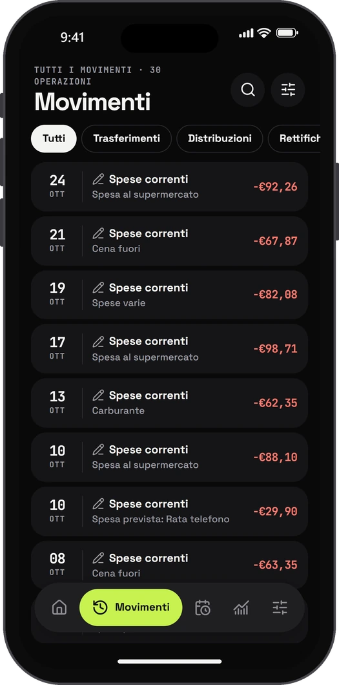 | 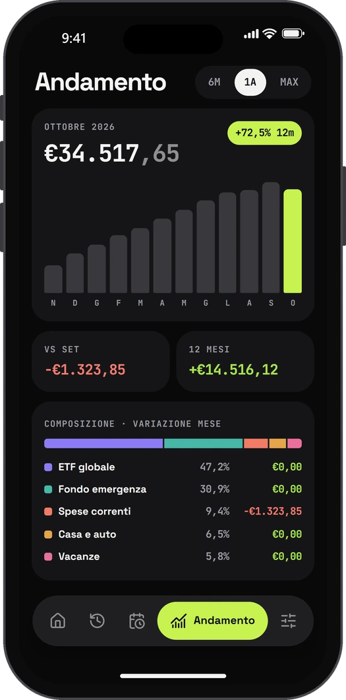 |

| Transfer | Bucket detail | Settings |
| :---: | :---: | :---: |
| 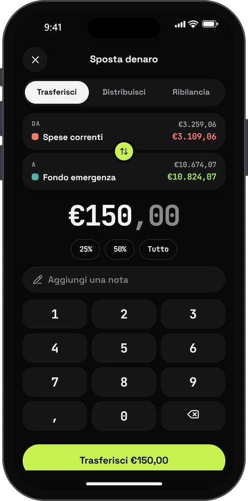 | 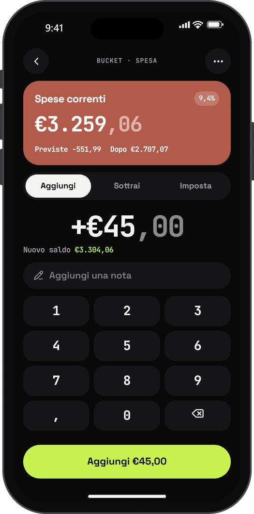 | 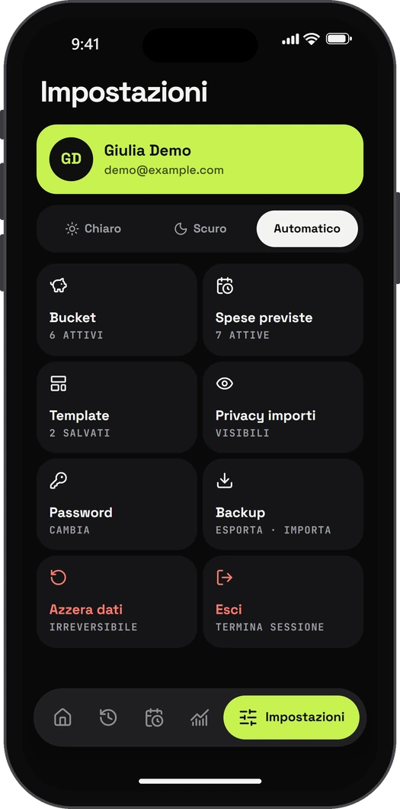 |

| Light theme | Planned expenses (light) | Sign in |
| :---: | :---: | :---: |
| 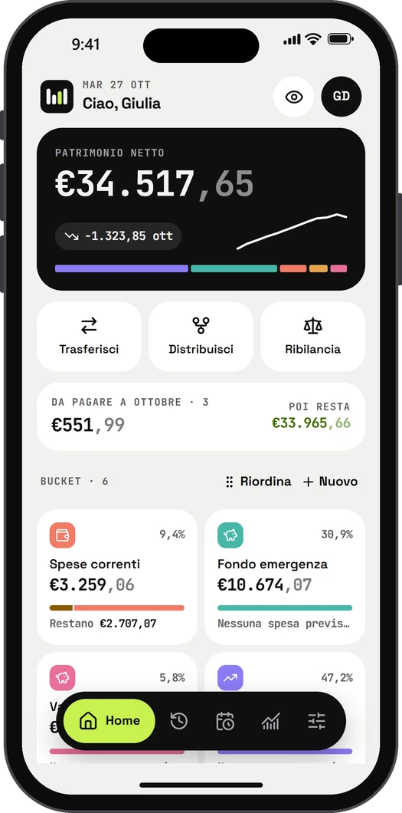 | 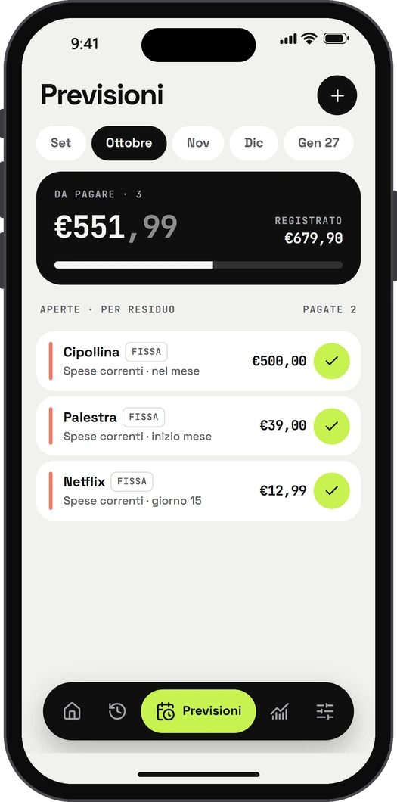 | 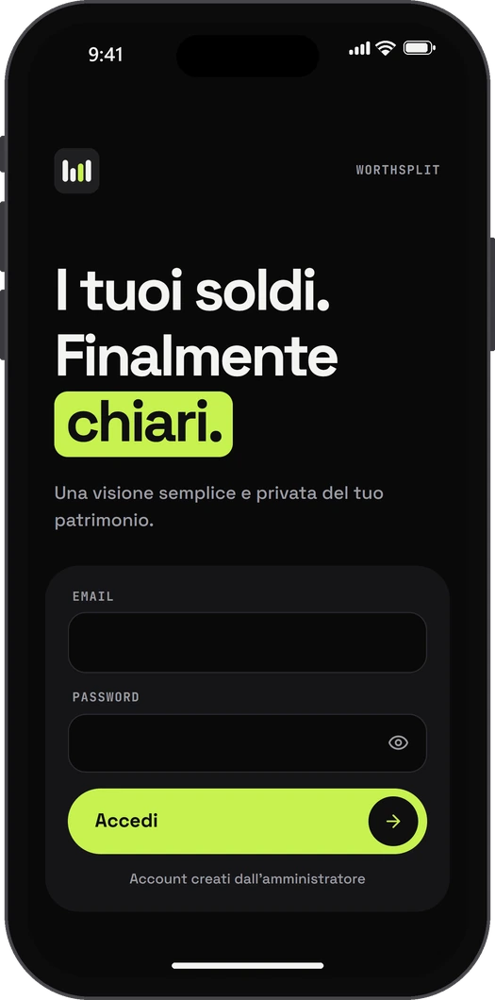 |

### Desktop

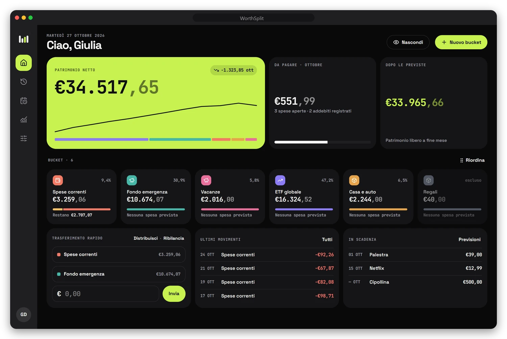

  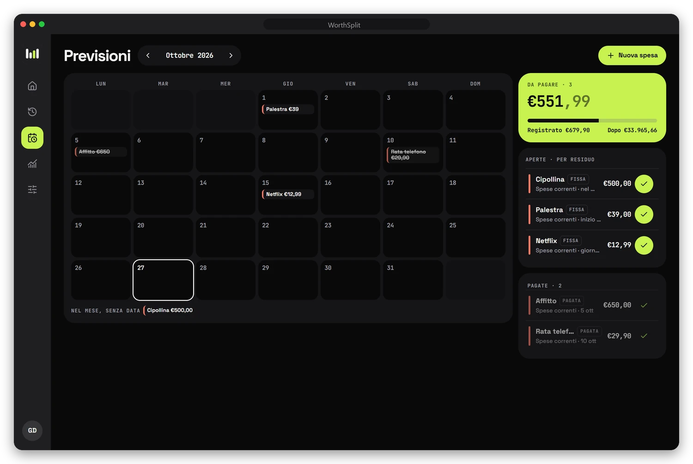
  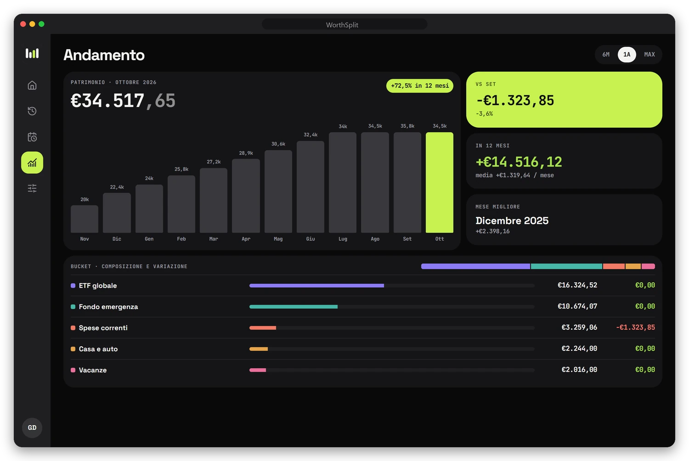

The screenshots show a demo account with fictitious data.

## Principles

- **Precision first.** Amounts are handled as integer cents: no accidental rounding in any calculation.
- **A history you can trust.** Every correction becomes a new operation: history is never rewritten.
- **Atomic operations.** Transfers, distributions and rebalances either complete in full or do not happen; the server recomputes everything and never trusts client previews.
- **Mobile first.** A keypad for amounts, large touch targets, iPhone safe areas and dialogs designed around the on-screen keyboard.
- **Self-contained.** No trackers, remote fonts, ads or external services needed to run it.

## Tech stack

React, TypeScript, Vite, Fastify, PostgreSQL, Docker Compose and PWA.

Local setup, build, tests, configuration and deployment are covered in the [technical guide](README.tecnico.md) (in Italian).

## License

Released under the [MIT](LICENSE) license. To report a vulnerability, follow [SECURITY.md](SECURITY.md).

---

WorthSplit is a personal project. Use it as an organisation tool: it is not financial advice.
